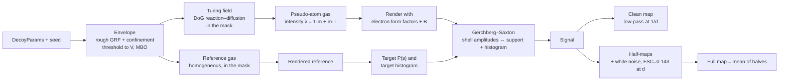

# decoygen: methods and design decisions

This document describes how `decoygen` v0 (milestone 1 of
[`decoy_density_brief.md`](../decoy_density_brief.md)) builds synthetic, non-protein
cryo-EM density maps, the mathematics behind each stage, and the reasoning behind the
design choices. Section numbers in brackets, e.g. [brief §4.1], refer to the brief.

Contents

1. [Goal and constraints](#1-goal-and-constraints)
2. [Pipeline overview](#2-pipeline-overview)
3. [Conventions](#3-conventions)
4. [Envelope](#4-envelope)
5. [Measuring roughness: the Richardson dimension](#5-measuring-roughness-the-richardson-dimension)
6. [Roughness calibration](#6-roughness-calibration)
7. [Mesoscale Turing field](#7-mesoscale-turing-field)
8. [Pseudo-atom gas and rendering](#8-pseudo-atom-gas-and-rendering)
9. [Target spectrum](#9-target-spectrum)
10. [Gerchberg–Saxton amplitude imposition](#10-gerchbergsaxton-amplitude-imposition)
11. [Clean map, half-maps and noise](#11-clean-map-half-maps-and-noise)
12. [Diagnostics](#12-diagnostics)
13. [Determinism](#13-determinism)
14. [Outputs](#14-outputs)
15. [Validation status](#15-validation-status)
16. [Known limitations and next steps](#16-known-limitations-and-next-steps)
17. [Parameter reference](#17-parameter-reference)
18. [References](#18-references)

---

## 1. Goal and constraints

A *decoy* is a 3D density map that matches proteins in **low-order statistics**
(1-point histogram, radial power spectrum, solvent fraction, volume per mass, envelope
roughness and compactness) but deliberately lacks **high-order, protein-specific
structure** (an unbranched chain, 3.8 Å Cα spacing, α-helices, β-sheets, side-chain
bumps, chirality) [brief §2]. Decoys serve as hard negatives for map-interpretation
networks such as ModelAngelo [Jamali 2024] and DeepEMhancer [Sanchez-Garcia 2021], and
as probes of hallucination.

**Hard constraint.** Nothing is trained or fitted on real maps or real atomic models.
Every number in the generator is either a physical/textbook constant (tier 0), a
published literature scalar (tier 1), or—behind an explicit opt-in—a 1D summary curve
(tier 3) [brief §1]. The tier of each constant is noted where it is used.

**Core idea.** Two maps with the same power spectrum differ only in their Fourier phases,
so the goal is *protein-like amplitudes with non-protein phases*. Because the radial
power spectrum is an orientational average, spectral features such as a ~10 Å or ~4.7 Å
peak can come from isotropic pair correlations (a "liquid" with preferred spacings)
rather than from rods and sheets. Every spectral feature in `decoygen` is therefore
produced by isotropic statistics, never by building secondary-structure-like objects.

## 2. Pipeline overview

Code map: `envelope.py` (§4), `roughness.py` and `calibration.py` (§5–6),
`turing.py` (§7), `atoms.py` (§8), `spectrum.py` (§9), `projection.py` (§10),
`noise.py` (§11), `diagnostics.py` (§12), `pipeline.py` (orchestration), `io.py`
(MRC/JSON), `cli.py`.

## 3. Conventions

| Item | Convention |
|---|---|
| Arrays | cubic `(n, n, n)`, float32, indexed `[z, y, x]` (MRC order) |
| Real space | voxel `i` sits at `i · apix` Å; map origin 0 |
| Reciprocal space | spatial frequency **s** in Å⁻¹, `s = |s| = 1/d`; this is *not* sin θ/λ (which is s/2) |
| FFT | periodic real FFT (`torch.fft.rfftn`), unnormalized forward transform |
| Fourier units | continuous transform `F(s) ≈ apix³ · DFT(ρ)`, so DFT power = \|F\|² / apix⁶ |
| Shells | index `round(s · n · apix)`; shells beyond Nyquist (cube corners) are kept as their own shells |
| Density units | electron scattering potential in Å⁻² (form factors in Å, divided by volume); absolute scale is not normalized |

Gaussian blurs are done in Fourier space (`exp(−2π²σ²s²)`), so they are periodic and
cost one FFT pair on the GPU.

## 4. Envelope

### 4.1 Volume from mass (tier 0)

The envelope volume is `V = v̄ · M` with `v̄ = 1.21 ų/Da`, corresponding to an average
protein density of ≈1.35 g cm⁻³ (1 Da = 1.6605 × 10⁻²⁴ g gives 1.23 ų/Da at
1.35 g cm⁻³; the brief's 1.21 is used as the default). Protein density depends weakly on
mass [Fischer 2004]; see also [partial specific volume](https://en.wikipedia.org/wiki/Partial_specific_volume).
The equivalent-sphere radius is `R = (3V/4π)^{1/3}`; 100 kDa gives V = 121 000 ų and
R = 30.7 Å.

### 4.2 Rough random field

The surface roughness comes from a [Gaussian random field](https://en.wikipedia.org/wiki/Gaussian_random_field)
(GRF) with power spectrum `P(k) ∝ k^{−α}`. In *d* dimensions a GRF with spectral exponent
`α = 2H + d` is a fractional Gaussian field whose increments scale as `|Δx|^H`
([Hurst exponent](https://en.wikipedia.org/wiki/Hurst_exponent) *H*, generalizing
[fractional Brownian motion](https://en.wikipedia.org/wiki/Fractional_Brownian_motion)).
Its level sets have [fractal dimension](https://en.wikipedia.org/wiki/Fractal_dimension)
`D = d − H` [Mandelbrot 1982; Adler 1981]. With d = 3:

$$
H = \frac{\alpha - 3}{2}, \qquad D = 3 - H = \frac{9 - \alpha}{2}, \qquad \alpha = 9 - 2D ,
$$

valid for 3 < α < 5 (0 < H < 1) [brief §4.1].

**Why α alone is not enough (the self-affine crossover).** Under the confinement term
(§4.3), the level-set surface is effectively the graph of a *self-affine* displacement
field `h(u)` over a smooth closed surface, with `⟨|h(u+ℓ) − h(u)|⟩ ≈ σ_h (ℓ/ℓ₀)^H`.
Such a surface only looks fractal (area growing as resolution increases) on scales where
its slopes are of order one, i.e. below the crossover length `ℓ×` where
`h(ℓ×) ≈ ℓ×`. Above `ℓ×` it is flat at large scales and the measured dimension tends to
2 [Mandelbrot 1985]. The *amplitude* of the roughness therefore moves the crossover and,
in practice, sets the Richardson D measured between the resolution and R (§5), while α
sets the local Hurst exponent. The first version of the generator normalized the whole
GRF to unit variance, so for α ≥ 3 the fine-scale amplitude was negligible compared with
the confinement gradient: measured D only spanned 2.05–2.16 for α = 3.2–5.0, with
seed-to-seed scatter comparable to the whole α effect.

**Design: split field.** The GRF is split at the molecular scale `s_c = 1/R` with
complementary filters

$$
L(s) = \frac{1}{1 + (s/s_c)^4}, \qquad
c = \mathcal{F}^{-1}\!\left[W\, s^{-\alpha/2} L\right], \qquad
r = \mathcal{F}^{-1}\!\left[W\, s^{-\alpha/2} (1-L)\right],
$$

with `W` the transform of one white-noise realization; `c` (coarse: global lumpiness) and
`r` (fine: roughness) are each normalized to unit variance. The envelope field is

$$
f(\mathbf x) = c(\mathbf x) + a\, r(\mathbf x) - b\, q(\mathbf x),
$$

with roughness amplitude `a` (`roughness_amplitude`), confinement weight `b`
(`envelope_bias`) and confinement `q` (§4.3). Near the surface `q ≈ 1`, `|∇q| ≈ 2/R`, so
the fine displacement is roughly `δ ≈ a r R / (2b)`: the ratios `1/b` (global shape
irregularity) and `a/b` (roughness) are the effective knobs.

### 4.3 Confinement, domains and elongation

`q(x) = min_i d_i(x)² / R_i²` is a quadratic "bowl" per domain *i*, with
`R_i = (3V/(4π n))^{1/3}` for `n` domains. Domain centres are placed one at a time at
distance 1.6 R_i from a randomly chosen existing centre, in a random direction, and then
re-centred. Elongation `e ≥ 1` uses a volume-preserving anisotropic metric along a
random unit axis **u**:

$$
d^2 = \frac{(\Delta\cdot\mathbf u)^2}{e^2} + e\,\big(|\Delta|^2 - (\Delta\cdot\mathbf u)^2\big).
$$

`q` is smooth, so it controls global shape without adding fine-scale roughness. It also
makes a single compact object the overwhelmingly likely outcome, which the old
pure-threshold approach (appendix A.3 of the brief) achieved only by retrying.

### 4.4 Threshold to volume, largest component, cavity filling

The binary envelope is the largest connected component of `{f > t}` with enclosed
cavities filled, with `t` chosen so its volume is `V` (to 0.5%). Two facts make
bisection on `t` valid:

* Superlevel sets are nested: `t₁ > t₂ ⇒ {f > t₁} ⊆ {f > t₂}`. Every component of the
  smaller set lies inside a component of the larger, so the largest-component volume is
  non-increasing in `t`.
* Hole filling preserves inclusion: `A ⊆ B ⇒ fill(A) ⊆ fill(B)`, since the unbounded
  component of `Bᶜ` lies inside that of `Aᶜ`.

Bisection is done over the *rank* of the threshold in the sorted field values (between
the V-th and 4V-th largest value), which is scale-free and needs ~12 labelling passes.

*Periodic components.* The FFT-generated field is periodic, so an object may wrap around
the box. Components are labelled with face connectivity ([connected-component
labelling](https://en.wikipedia.org/wiki/Connected-component_labeling), `scipy.ndimage.label`),
and labels touching opposite faces are merged with a
[disjoint-set (union–find)](https://en.wikipedia.org/wiki/Disjoint-set_data_structure)
structure. This replaces the old 3×3×3 tiling (27× the memory).

*Periodic centring.* The object is rolled so that its [circular mean](https://en.wikipedia.org/wiki/Circular_mean)
position along each axis (angles `θ = 2πi/n`) sits at the box centre [Bai & Breen 2008].

*Cavity filling (design decision).* Rough, high-amplitude fields can produce closed
internal voids. At the resolutions of interest, protein envelopes do not contain large
solvent-filled cavities, and an internal void would create an internal mask surface that
alters the area and D measurements. Cavities are therefore filled (`binary_fill_holes`)
before the volume is measured.

### 4.5 Compactness: volume-preserving mean-curvature flow (MBO)

Surface tension is modelled by [mean-curvature flow](https://en.wikipedia.org/wiki/Mean_curvature_flow)
using the Merriman–Bence–Osher (MBO) diffusion-generated scheme [Merriman 1994]: blur
the indicator with a Gaussian of variance `2Δt`, then re-threshold. For small Δt this
moves the interface by mean curvature for time Δt. Volume is conserved by thresholding at
the quantile that keeps exactly V voxels, the volume-preserving variant [Ruuth & Wetton 2003].
Each step is followed by the solid-object projection of §4.4.

* Step blur σ = 2 voxels, so `Δt = σ²/2`; `compactness = τ` (Ų) gives
  `round(τ/Δt)` steps. Smaller σ suffers from grid pinning (the interface cannot move by
  less than a voxel).
* MCF removes the smallest scales first (high-curvature features flatten fastest) and
  makes the shape rounder overall, which is why it is a separate knob from D
  [brief §3]. Large τ also lowers the measured D, so the calibration (§6) is tied to
  the compactness value.

### 4.6 Edge clearance and retries

After centring, the envelope must leave `edge_clearance` Å (default 10) to every box
face. Up to 10 attempts are made with independent random streams (§13); the attempt
index is recorded in the JSON. `DecoyParams.validate()` rejects boxes that cannot fit
`2 × 1.6 R` plus clearance, since irregular envelopes empirically reach 1.5–1.9 R from
their centre. This is why the default mass is 100 kDa for the default 128 Å box.

## 5. Measuring roughness: the Richardson dimension

### 5.1 Area as a function of scale

The Richardson approach (the [coastline paradox](https://en.wikipedia.org/wiki/Coastline_paradox))
measures how the apparent surface area changes with the measuring scale. For protein
surfaces this gives D ≈ 2.1–2.4 [Lewis & Rees 1985]. Here the area at blur scale σ is
the [total variation](https://en.wikipedia.org/wiki/Total_variation) of the blurred
indicator χ:

$$
A(\sigma) = \int \left|\nabla (G_\sigma * \chi)\right| \, dV .
$$

By the [coarea formula](https://en.wikipedia.org/wiki/Coarea_formula) this equals
`∫₀¹ Area({G_σ*χ = λ}) dλ`, the mean area of the level sets of the smoothed object, so it
is the area "seen" at scale σ. The gradient is computed spectrally. For a fractal surface,
`A(σ) ∝ σ^{2−D}`.

### 5.2 Curvature bias and the equal-volume ball

Blurring moves a curved interface even when the surface is perfectly smooth. Diffusion
for time `t = σ²/2` moves the ½-level set of a sphere inward at speed equal to its
mean-curvature sum `2/R`, so

$$
r_{1/2} \approx R - \frac{\sigma^2}{R}, \qquad
A(\sigma) \approx 4\pi R^2 \left(1 - \frac{2\sigma^2}{R^2}\right),
$$

which a log–log fit reads as D > 2. Measured on voxelized balls, the raw estimator gives
D = 2.07 at R = 20 Å and 2.17 at R = 12 Å for perfectly smooth spheres.

**Fix (design decision):** fit the ratio to an equal-volume ball measured the same way:

$$
D = 2 - \frac{d \log\!\big(A_\text{mask}(\sigma)/A_\text{ball}(\sigma)\big)}{d \log \sigma}.
$$

This cancels the curvature term to first order. Residuals on smooth ellipsoids (96³,
equal volume to an 18 Å ball): +0.000 (sphere), +0.015 (1.6× elongation),
+0.052 (2.5×). Both raw and corrected values are stored (`D_raw`, `D`).

### 5.3 Fit range

The fit uses 8 log-spaced σ in `[max(d/2, apix), R/3]`. Below d/2 the map cannot resolve
the surface, and above R/3 the blur reaches the scale of the whole molecule. This is
usually less than one decade (1.75–10 Å for 100 kDa at 3.5 Å), so D is best read as a
*roughness exponent* over that window, not as a true fractal dimension [brief §3].

### 5.4 Related shape statistics

* [Sphericity](https://en.wikipedia.org/wiki/Sphericity) `Ψ = π^{1/3}(6V)^{2/3}/A`
  [Wadell 1935], using the area at σ = d/2.
* The area at σ = d/2 compared with the literature SASA scaling `A_s ≈ 6.3 M^{0.73}` Ų
  [Miller 1987] (tier 1). The probe scale differs (1.4 Å water probe versus resolution
  blur), so only the scaling with M is comparable, not absolute values.

## 6. Roughness calibration

The mapping from parameters to measured D is shifted by largest-component selection,
cavity filling, MBO, the binary projection and the finite fit window [brief §4.1 step 5,
§8], so it is measured, not assumed.

**Procedure** (`decoygen calibrate`, `scripts/calibrate.sbatch`): for a grid of
α × amplitude (default α ∈ {3.8, 4.0, …, 5.0}, a ∈ {0, 0.1, 0.2, 0.3, 0.45, 0.6, 0.8,
1.0, 1.3, 1.7}), generate envelopes for 4 seeds with the default envelope settings and
record the mean and standard deviation of D and the number of successful envelopes.

**Inversion** (`roughness.roughness_parameters`): for a target D,

1. α = 9 − 2D (the theoretical local exponent), unless set explicitly;
2. the table row at that α is linearly interpolated between the neighbouring α rows,
   made monotone in amplitude (`np.maximum.accumulate`), and inverted for the amplitude
   giving D. Out-of-range targets are clamped with a warning.

The two knobs are tied deliberately: α keeps its theoretical meaning (local Hurst
exponent), and the amplitude puts the crossover where the measured D matches the target.
Explicit `alpha` or `roughness_amplitude` override the table. The JSON records `alpha`,
`roughness_amplitude` and their sources (`theory`, `calibration`, `user` or
`uncalibrated`).

**Scope.** A table is valid for the envelope settings it was built with (stored under
`base_params`: box, apix, resolution, mass, compactness, domains, elongation, bias,
clearance). The packaged table is used by default. `$DECOYGEN_CALIBRATION` points to
another one.

**Results** for the default settings: see [§6.1](#61-calibration-results).

### 6.1 Calibration results

Default envelope settings (128³, 1 Å/px, 3.5 Å, 100 kDa, compactness 8 Ų, bias 1.5,
clearance 10 Å), 4 seeds per cell, Richardson window 1.75–10.2 Å. Mean measured D:

| α \ a | 0 | 0.1 | 0.2 | 0.3 | 0.45 | 0.6 | 0.8 | 1 | 1.3 | 1.7 |
|---|---|---|---|---|---|---|---|---|---|---|
| 3.8 | 2.042 | 2.049 | 2.060 | 2.073 | 2.097 | 2.121 | 2.159 | 2.208 | 2.271 | 2.340 |
| 4.0 | 2.039 | 2.045 | 2.056 | 2.071 | 2.096 | 2.123 | 2.169 | 2.216 | 2.281 | 2.353 |
| 4.2 | 2.036 | 2.042 | 2.052 | 2.068 | 2.097 | 2.128 | 2.174 | 2.223 | 2.290 | 2.365 |
| 4.4 | 2.033 | 2.039 | 2.049 | 2.065 | 2.099 | 2.130 | 2.178 | 2.229 | 2.297 | 2.373 |
| 4.6 | 2.030 | 2.036 | 2.047 | 2.063 | 2.099 | 2.134 | 2.182 | 2.231 | 2.300 | 2.379 |
| 4.8 | 2.028 | 2.034 | 2.045 | 2.062 | 2.098 | 2.132 | 2.184 | 2.234 | 2.305 | 2.376 |
| 5.0 | 2.026 | 2.032 | 2.043 | 2.059 | 2.097 | 2.132 | 2.186 | 2.235 | 2.307 | 2.386 |

* The reachable range is **D ≈ 2.03–2.39**, covering the protein range 2.1–2.4
  [Lewis & Rees 1985] up to ~2.38. Targets outside it are clamped with a warning.
* At fixed amplitude, α has only a weak effect (≤0.05). The amplitude dominates, as
  expected from the crossover argument in §4.2. Before the split-field change, α alone
  reached only 2.05–2.16.
* All 280 envelopes met the clearance (no failed cells). The per-cell seed standard
  deviation is 0.01–0.05, largest at high amplitude. **D is matched as an ensemble mean;
  an individual decoy typically lands within ±0.05 of the target.** For example, D = 2.25
  gave 2.21 for seed 0.
* The packaged table is `decoygen/data/roughness_calibration.json`. Rebuild it with
  `sbatch scripts/calibrate.sbatch` (about 8 min on one A100) whenever the envelope
  pipeline or its default settings change.

## 7. Mesoscale Turing field

### 7.1 Model

Protein density has a characteristic ~10 Å mesoscale modulation (helix packing).
`decoygen` produces a statistically similar modulation with a
[Turing pattern](https://en.wikipedia.org/wiki/Turing_pattern) [Turing 1952] in the
kernel-based activator–inhibitor form [Young 1984; Kondo & Miura 2010]:

$$
x \leftarrow \tanh\!\Big(x + \Delta t\,\big(\mathcal F^{-1}[\,g(s)\,\mathcal F[x]\,] + h\big)\Big)
\quad\text{inside the mask}, \qquad x = 0 \text{ outside}.
$$

Linearizing around `x = 0`, each Fourier mode grows at a rate proportional to `g(s)`, so
the fastest-growing wavelength `λ = 1/s*` wins. `tanh` saturates the amplitude, and the
competition between modes is winner-take-all in |s|. **g sets the morphology, not the
final spectrum**, which is imposed later (§10) [brief §4.2].

### 7.2 Designed growth function

`g` is a [difference of Gaussians](https://en.wikipedia.org/wiki/Difference_of_Gaussians)
(short-range activation, long-range inhibition):

$$
g(s) = e^{-2\pi^2\sigma_s^2 s^2} - e^{-2\pi^2\sigma_l^2 s^2},\qquad \sigma_l = q\,\sigma_s .
$$

Setting `dg/ds = 0` with `a = 2π²σ_s²`, `b = 2π²σ_l²` gives `a e^{−a s²} = b e^{−b s²}`, so

$$
s^{*2} = \frac{\ln(\sigma_l^2/\sigma_s^2)}{2\pi^2(\sigma_l^2-\sigma_s^2)}
\quad\Longrightarrow\quad
\sigma_s = \lambda\,\sqrt{\frac{\ln q^2}{2\pi^2(q^2-1)}} .
$$

The generator is parameterized by the wavelength `λ = meso_wavelength` (Å) and the ratio
`q = turing_quotient`, and solves for σ_s, σ_l. The old "vermiculation" preset
(σ_s = 1, σ_l = 4 px) corresponds to λ ≈ 10.3 px (checked in the tests). `g` is
normalized to `g(s*) = 1`, so `turing_dt` is the per-iteration linear growth rate of
the dominant mode. Since `g(0) = 0`, the mean is neutral.

### 7.3 Fill-fraction control

Without a bias term, the symmetric `tanh` dynamics settle near a 50:50 split. To form
other morphologies *during* pattern formation (rather than thresholding a 50:50 pattern
afterwards), a scalar bias `h` is driven by integral feedback:

$$
h \leftarrow h + \kappa\,\big(f^* - \text{frac}(x > 0 \mid \text{mask})\big),\qquad \kappa = 0.5 .
$$

As the fill fraction `f*` falls from 0.5 the morphology passes through bicontinuous
labyrinths ([gyroid](https://en.wikipedia.org/wiki/Gyroid)-like) → tubes → spots,
mirroring microphase-separation phase diagrams. **Tubes ~5 Å wide at ~10 Å spacing
resemble helices or backbone at 4–6 Å resolution** [brief §8], so the default is
`f* = 0.5`. A labyrinth has many Y-junctions and closed loops, both non-protein
features. The dynamics are mirror-symmetric, so the ensemble is achiral (§12).

### 7.4 Output

`T = (x + 1)/2 ∈ [0, 1]` inside the mask, 0 outside, mixed into the atom intensity

$$
\lambda(\mathbf x) = \big(1 - m\big) + m\, T(\mathbf x), \qquad m = \texttt{meso\_strength}.
$$

Low `m` gives a statistical density wave. High `m` gives visible worms, which look more
protein-like and should be avoided [brief §3].

## 8. Pseudo-atom gas and rendering

### 8.1 Atom count and composition (tier 0)

The number of heavy (non-hydrogen) atoms is `N = M / m̄` with `m̄ = 14.1 Da` per heavy
atom. That is an average residue of ~110 Da with ~7.8 heavy atoms, the hydrogen mass
counted in `m̄`. With `v̄ = 1.21 ų/Da` this gives one heavy atom per
`1.21 × 14.1 ≈ 17.1 ų` [brief §4.3]. Composition by count is C 0.63, N 0.17, O 0.19,
S 0.01, from average amino-acid formulae. Hydrogens are not rendered as separate
scatterers; this matches common map simulators and is revisited in milestone 2.

### 8.2 Inhomogeneous Poisson gas (v0)

v0 draws positions from an [inhomogeneous Poisson process](https://en.wikipedia.org/wiki/Poisson_point_process)
with intensity ∝ λ(x) in the mask. It draws N voxels from a multinomial with
probabilities ∝ λ, then jitters each position uniformly within its voxel. There is no hard
core, so the pair correlation is flat (structure factor S(s) = 1), the "random-atom" model
of Wilson statistics. Milestone 2 replaces this with a two-scale hard-core process and
[reverse Monte Carlo](https://en.wikipedia.org/wiki/Reverse_Monte_Carlo) fitting to a
target S(s) [McGreevy & Pusztai 1988; brief §4.3]. In v0 the atoms only seed realistic
high-resolution phases and the histogram; the final map is the Gerchberg–Saxton output
(§10), so v0 writes no pseudo-atom mmCIF.

### 8.3 Electron scattering factors (tier 0)

Cryo-EM maps are maps of electrostatic potential, so the relevant
[form factors](https://en.wikipedia.org/wiki/Atomic_form_factor) are *electron*
scattering factors. `decoygen` uses the 5-Gaussian elastic fits of International Tables
Vol. C Table 4.3.2.2 [Peng 1996], read from gemmi (`Element.c4322`) [Wojdyr 2022]:

$$
f_e(s) = \sum_{i=1}^{5} a_i \exp\!\left(-b_i \frac{s^2}{4}\right), \qquad \frac{s^2}{4} = \left(\frac{\sin\theta}{\lambda}\right)^2 .
$$

An isotropic [Debye–Waller factor](https://en.wikipedia.org/wiki/Debye%E2%80%93Waller_factor)
multiplies by `exp(−B s²/4)`. Using the Fourier pair
`exp(−4π² r²/β) ↔ (β/4π)^{3/2} exp(−β s²/4)`, the real-space density of one atom is

$$
\rho(r) = \sum_i a_i \left(\frac{4\pi}{b_i + B}\right)^{3/2} \exp\!\left(-\frac{4\pi^2 r^2}{b_i + B}\right),
\qquad \int \rho\, dV = \sum_i a_i = f_e(0).
$$

### 8.4 Rendering

Atoms are splatted in real space onto all voxels within a cutoff radius, chosen so the
widest Gaussian falls below 10⁻⁴ of its peak: `r_c = √((b_max + B) ln 10⁴)/(2π)`, about
4.7 Šfor B = 40 Ų. The splatting wraps periodically. Contributions are summed
**deterministically**: flat voxel indices are stable-sorted and segment-summed with a
float64 cumulative sum, which avoids GPU atomic adds and their run-to-run rounding
differences. The renderer is validated against the analytic transform (|F| = f_e(s)e^{−Bs²/4}
to 0.2%) and against gemmi's `DensityCalculatorE` (agreement to 0.2% of the peak).

## 9. Target spectrum

### 9.1 Random-atom model

For N atoms with number density n inside an envelope with indicator `M(x)`, the expected
intensity is

$$
\langle |F(\mathbf s)|^2 \rangle \;=\; \underbrace{|\langle f(s)\rangle|^2\, n^2\, |\hat M(\mathbf s)|^2}_{\text{envelope (shape) term}}
\;+\; \underbrace{N \langle f(s)^2\rangle\, S(s)}_{\text{atomic (Wilson) term}},
$$

where S(s) is the [structure factor](https://en.wikipedia.org/wiki/Structure_factor) of
the atomic arrangement [Wilson 1949]. For the Poisson gas S = 1. The envelope term
dominates at low s (below ~1/20 Å⁻¹), the atomic term at high s.

### 9.2 Reference and targets

Rather than evaluating the envelope term analytically, `decoygen` renders a
**homogeneous** Poisson gas (λ = 1) in the same envelope with the same N, B and
composition. Its radial power `P_ref(s)` is the `physics` target (pure tier 0), and the
values of its density inside the support give the target 1-point histogram. Structure-factor
modifications act only on the atomic term:

$$
P_\text{target}(s) = P_\text{ref}(s) + \big(S_\text{mult}(s) - 1\big)\, W(s), \qquad
W(s) = \frac{N\,\langle f_e(s)^2\rangle\, e^{-Bs^2/2}}{\text{apix}^6}.
$$

| `target_spectrum` | `S_mult(s)` | Tier |
|---|---|---|
| `physics` (default) | 1 | 0 |
| `physics+peaks` | `1 + Σ_j h_j exp(−(s − 1/d_j)² / (2 (w/d_j)²))`, default d = 10 Å, 4.7 Å; h = 0.5, 0.3; w = 0.15 | 0 + free parameters |
| `best` | user file (s, S_mult), e.g. derived from the BEST curve [Popov & Bourenkov 2003] | 3, needs `allow_tier3=True` |

Peaks are placed by their position *in the spectrum*, s = 1/d. A real-space pair
correlation peak at distance r produces an S(s) maximum nearer s ≈ 1.2/r [brief §4.3], so
when peaks are later derived from pair potentials (milestone 2) their positions will need
numerical calibration. In milestone 4 the peak heights and positions become free
parameters of the critic-driven optimizer [brief §6.2]. The difference between `physics`
and protein-like spectra is roughly the secondary-structure signature, which is what is
being controlled [brief §4.3].

## 10. Gerchberg–Saxton amplitude imposition

The modulated gas `x₀` (Turing-shaped intensity) has natural high-resolution phases,
but its amplitudes carry the Turing modulation. The target amplitudes and histogram are
imposed by [Gerchberg–Saxton](https://en.wikipedia.org/wiki/Gerchberg%E2%80%93Saxton_algorithm)-style
alternating projections [Gerchberg & Saxton 1972; Fienup 1982]
(see also [phase retrieval](https://en.wikipedia.org/wiki/Phase_retrieval)), here used for
*synthesis*: keep the phases, change the amplitudes.

Repeat `gs_iterations` times (default 20):

1. **Fourier step.** For each shell `k`, multiply every coefficient by
   `√(P_target,k / P_k)`, where `P_k` is the shell's current mean power.
   *Design decision:* rescaling per shell keeps the relative amplitudes within a shell,
   so the Rayleigh-like speckle statistics of a real structure survive. The old notebook
   instead set every coefficient to the target magnitude ("whitening"), which gives
   unnaturally uniform amplitudes and a non-Gaussian look.
2. **Real-space step.** Zero everything outside the support (the envelope blurred by
   σ = 2 Å and thresholded at 0.01, so atoms straddling the envelope keep their tails),
   and [histogram-match](https://en.wikipedia.org/wiki/Histogram_matching) inside it by
   rank to the reference values. The reference density is non-negative, so this also
   enforces positivity.

The loop ends on the real-space step, so the real-space constraints hold exactly and the
spectrum approximately. The histogram constraint is not convex, so there is no
convergence guarantee. The per-iteration spectral error
`rms_s log₁₀(P/P_target)` over shells from 1/R to Nyquist is recorded
(`gs_spectral_error_history`). In practice it reaches ~10⁻³ within 20 iterations.

The phases come from the *modulated* gas, so the Turing morphology survives as phase
structure while the radial spectrum is reset to the target. The mesoscale texture is
present without a spectral signature beyond the chosen target [brief §2].

## 11. Clean map, half-maps and noise

**Signal and clean map.** The GS output is the *signal* (form factors and B included,
full bandwidth to Nyquist). The *clean* map, the noise-free target for supervised pairs,
is the signal low-passed with a raised cosine that is 1 below `1/d` and 0 above `1.1/d`.

**Noise model (`white`).** Each half-map is `signal + n_i`, with `n_i` independent white
Gaussian noise of power `N₀` per Fourier coefficient. For half-maps with SNR(s), the
expected [FSC](https://en.wikipedia.org/wiki/Fourier_shell_correlation) is
`FSC_half = SNR/(1 + SNR)`. The gold-standard resolution criterion is
`FSC_half(1/d) = 0.143` [Rosenthal & Henderson 2003; Scheres & Chen 2012], i.e.
`SNR_c = 0.143/0.857 ≈ 0.167`. So

$$
N_0 = \frac{P_\text{signal}(1/d)}{\text{SNR}_c \cdot \texttt{snr\_scale}}, \qquad
\sigma_\text{voxel} = \sqrt{N_0 / n^3}
$$

(white noise with unit voxel variance has mean DFT power n³). With `snr_scale = 1` the
half-map FSC crosses 0.143 at the nominal resolution (3.51 Å measured for a 3.5 Å target).
The shape of the FSC curve then follows from the signal's own decay (form factors, B), as
in real reconstructions. The same noise covers the solvent, so the final map has no mask
edge. The full map is the mean of the two halves.

*Design note.* An earlier design set SNR(s) = SNR₀ exp(−k s²) directly. Noise power
`P_sig/SNR` then grows like `exp(+k s²)` and explodes beyond the resolution limit. White
noise is the simplest physically reasonable model: after averaging, reconstruction noise
is roughly flat while the signal decays. CTF-envelope and anisotropic noise are not
modelled in v0.

## 12. Diagnostics

All are tier 0 and stored in the per-decoy JSON (scalars) and the plot (curves):

| Diagnostic | Definition |
|---|---|
| `volume_ratio` | envelope volume / target V |
| `richardson_D`, `D_raw` | §5 |
| `sphericity`, `surface_area_over_sasa` | §5.4 |
| `spectrum_log10_rms_error`, `_max_error` | signal versus target over shells 1/R … Nyquist |
| `halfmap_fsc_resolution_A` | first FSC_half crossing of 0.143, linearly interpolated |
| `histogram_signal` / `_reference` | mean, standard deviation, skew inside the support |
| `structure_tensor_*` | Westin measures of the [structure tensor](https://en.wikipedia.org/wiki/Structure_tensor) `J = G_d * (∇ρ ∇ρᵀ)` of the clean map inside the mask [Westin 2002]: linearity `c_l = (λ₁−λ₂)/λ₁` (rod-like, helix/backbone-like), planarity `c_p = (λ₂−λ₃)/λ₁` (sheet-like), sphericity `c_s = λ₃/λ₁` |
| `chirality` | pseudoscalar `χ = Σ ∇ρ·(∇Δρ × ∇Δ²ρ) / Σ |∇ρ||∇Δρ||∇Δ²ρ|` over the mask |
| `chirality_reference` | the same for the low-passed homogeneous gas (null reference) |

The chirality statistic is a [pseudoscalar](https://en.wikipedia.org/wiki/Pseudoscalar):
the triple product of three gradients changes sign under reflection (verified exactly by
a test), so its ensemble mean vanishes for achiral processes. Right-handed α-helices give
proteins a systematic sign. Decoys should scatter around zero like the reference.

Junction density (skeleton Y-junctions per volume), a non-protein marker, is planned but
not yet implemented.

## 13. Determinism

* One integer `seed` determines everything. Each stage (`envelope`, `turing`, `atoms`,
  `reference`, `noise_half1`, `noise_half2`) gets its own stream from
  `numpy.random.SeedSequence([seed, stage, attempt])`, so changing one stage (e.g.
  more Turing iterations) does not change the random numbers of the others.
* All random draws are made on the CPU with `torch.Generator` and then moved to the
  device, so the *inputs* are identical on CPU and GPU.
* Shell averages and atom splatting use sort + float64 cumulative sums instead of atomic
  scatter-adds, so they are deterministic on GPU.
* Bit-identical output is tested on CPU. On GPU, cuFFT and CPU FFT round differently, so
  CPU and GPU results agree to float32 rounding, not bit for bit. Repeated runs on the
  same device and library versions are reproducible. Versions are recorded in every JSON.

## 14. Outputs

Per decoy (`decoy_<seed:06d>/` unless `--name` is given):

| File | Content |
|---|---|
| `NAME.mrc` | full map (mean of the half-maps) |
| `NAME_half_1.mrc`, `NAME_half_2.mrc` | half-maps |
| `NAME_clean.mrc` | noise-free, low-passed at 1/d |
| `NAME_mask.mrc` | binary envelope (0/1) |
| `NAME_turing.mrc` | Turing field (`--extra-maps`) |
| `NAME_diagnostics.png` | summary figure (`--plots`) |
| `NAME.json` | all parameters, resolved α/amplitude, seeds/attempts, timings, versions, diagnostics |

MRC files follow MRC2014 [Cheng 2015]: mode 2 (float32), voxel size in the header,
origin 0, `nxstart = nystart = nzstart = 0`, axis order mapc/mapr/maps = 1/2/3, cubic
even box. Headers are re-read and checked after every write. `decoygen batch` also writes
`manifest.csv` with paths, all parameters and flattened diagnostics. Real EMDB/PDB
identifiers and protein residue names are never used [brief §8].

For viewing in ChimeraX, see `scripts/chimerax_decoys.py` and the README.

## 15. Validation status

The test suite (`pytest`, CI on Python 3.10 and 3.12) covers:

* Fourier utilities: flat white-noise spectrum, deterministic shell means equal to
  `bincount`, sum-preserving blur.
* DoG peak position, and the old vermiculation preset reproduced (σ = 1/4 px ↔ λ = 10.3 px).
* Turing fill-fraction feedback (target ±0.03), zero field outside the mask.
* Richardson D = 2.00 ± 0.01 for a ball and 2.00 ± 0.03 for a smooth 1.6× ellipsoid;
  ball area within 5%.
* Periodic labelling across faces, envelope volume (±2%), clearance, single component,
  no cavities. A larger roughness amplitude gives a larger D, and the calibration table
  inverts correctly.
* Renderer: integral = f_e(0), transform matches the analytic form factor, agreement
  with gemmi `DensityCalculatorE`.
* End to end: bit-identical repeat runs, different seeds give different maps, volume,
  spectrum error < 0.05 decades, half-map FSC within 15% of the target resolution,
  `physics+peaks` raises power at the peak, tier-3 opt-in enforced, chirality sign flips
  under mirroring, full map = mean of halves, MRC headers valid (`mrcfile.validate`).

Performance: a default 128³ decoy takes ~3 s on an A100. The envelope takes ~2.5 s,
mostly CPU connected-component labelling, cavity filling and centring inside the
threshold bisection and the MBO steps. Every other stage takes < 0.5 s, and diagnostics
~0.3 s. Moving labelling to the GPU or filling cavities only once are obvious
optimizations if throughput matters.

## 16. Known limitations and next steps

* **v0 atoms carry no structure.** S(s) = 1, so `physics` has no liquid-like
  correlation peaks. The hard-core sampler and RMC (milestone 2) will supply
  physically motivated S(s) and an atomistic model consistent with the final map.
* GS output is not exactly an atomistic density. The histogram and spectrum match the
  reference, but higher-order statistics come from GS dynamics.
* The noise is white and isotropic: no CTF envelope, anisotropy or local-resolution
  variation.
* The calibration is valid only for the envelope settings it was built with. Other
  masses, compactness or bias values shift D (§6).
* Junction density and a protein-likeness critic are not implemented (milestones 3–4).
* Hydrogens are not rendered.

## 17. Parameter reference

| Parameter | Default | Meaning |
|---|---|---|
| `box` | 128 | cubic box edge (voxels), even |
| `apix` | 1.0 | voxel size (Å) |
| `resolution` | 3.5 | target resolution d (Å) |
| `mass_kda` | 100 | sets V = 1.21 ų/Da × M |
| `roughness_D` | 2.25 | target Richardson D (via calibration) |
| `alpha` | 9 − 2D | GRF spectral exponent (override) |
| `roughness_amplitude` | from table | fine/coarse GRF amplitude a (override) |
| `compactness` | 8 Ų | MBO mean-curvature-flow time |
| `n_domains`, `elongation` | 1, 1.0 | global shape |
| `envelope_bias` | 1.5 | confinement weight b |
| `edge_clearance` | 10 Å | envelope-to-box-edge margin |
| `meso_wavelength` | 10 Å | Turing wavelength λ |
| `meso_strength` | 0.3 | m in λ(x) = 1 − m + mT |
| `fill_fraction` | 0.5 | Turing fill fraction f* |
| `turing_quotient`, `turing_iterations`, `turing_dt` | 4, 200, 0.3 | DoG ratio, iterations, step |
| `target_spectrum` | `physics` | `physics` / `physics+peaks` / `best` |
| `peak_d`, `peak_heights`, `peak_rel_width` | (10, 4.7), (0.5, 0.3), 0.15 | spectral bumps |
| `spectrum_file`, `allow_tier3` | –, false | tier-3 multiplier file |
| `gs_iterations` | 20 | Gerchberg–Saxton iterations |
| `bfactor` | 40 Ų | isotropic B |
| `noise_model` | `white` | `white` / `none` |
| `snr_scale` | 1.0 | half-map SNR multiplier (1 → FSC = 0.143 at d) |
| `seed` | 0 | integer seed |

## 18. References

* Adler RJ (1981) *The Geometry of Random Fields*. Wiley.
* Bai L, Breen D (2008) Calculating center of mass in an unbounded 2D environment. *J Graphics Tools* 13:53–60. doi:10.1080/2151237X.2008.10129266
* Cheng A, Henderson R, Mastronarde D, et al. (2015) MRC2014: Extensions to the MRC format header for electron cryo-microscopy and tomography. *J Struct Biol* 192:146–150. doi:10.1016/j.jsb.2015.04.002 — [format spec](https://www.ccpem.ac.uk/mrc_format/mrc2014.php)
* Fienup JR (1982) Phase retrieval algorithms: a comparison. *Appl Opt* 21:2758–2769. doi:10.1364/AO.21.002758
* Fischer H, Polikarpov I, Craievich AF (2004) Average protein density is a molecular-weight-dependent function. *Protein Sci* 13:2825–2828. doi:10.1110/ps.04688204
* Gerchberg RW, Saxton WO (1972) A practical algorithm for the determination of phase from image and diffraction plane pictures. *Optik* 35:237–246.
* Jamali K, Käll L, Zhang R, et al. (2024) Automated model building and protein identification in cryo-EM maps. *Nature* 628:450–457. doi:10.1038/s41586-024-07215-4 (ModelAngelo)
* Kondo S, Miura T (2010) Reaction-diffusion model as a framework for understanding biological pattern formation. *Science* 329:1616–1620. doi:10.1126/science.1179047
* Lewis M, Rees DC (1985) Fractal surfaces of proteins. *Science* 230:1163–1165. doi:10.1126/science.4071040
* Mandelbrot BB (1982) *The Fractal Geometry of Nature*. Freeman.
* Mandelbrot BB (1985) Self-affine fractals and fractal dimension. *Physica Scripta* 32:257–260. doi:10.1088/0031-8949/32/4/001
* McGreevy RL, Pusztai L (1988) Reverse Monte Carlo simulation: a new technique for the determination of disordered structures. *Mol Simul* 1:359–367. doi:10.1080/08927028808080958
* Merriman B, Bence JK, Osher SJ (1994) Motion of multiple junctions: a level set approach. *J Comput Phys* 112:334–363. doi:10.1006/jcph.1994.1105
* Miller S, Janin J, Lesk AM, Chothia C (1987) Interior and surface of monomeric proteins. *J Mol Biol* 196:641–656. doi:10.1016/0022-2836(87)90038-6
* Peng L-M, Ren G, Dudarev SL, Whelan MJ (1996) Robust parameterization of elastic and absorptive electron atomic scattering factors. *Acta Cryst A* 52:257–276. doi:10.1107/S0108767395014371
* Popov AN, Bourenkov GP (2003) Choice of data-collection parameters based on statistic modelling. *Acta Cryst D* 59:1145–1153. doi:10.1107/S0907444903008163
* Romano Y, Elad M, Milanfar P (2017) The little engine that could: regularization by denoising (RED). *SIAM J Imaging Sci* 10:1804–1844. doi:10.1137/16M1102884 (brief §6.1)
* Rosenthal PB, Henderson R (2003) Optimal determination of particle orientation, absolute hand, and contrast loss in single-particle electron cryomicroscopy. *J Mol Biol* 333:721–745. doi:10.1016/j.jmb.2003.07.013
* Ruuth SJ, Wetton BTR (2003) A simple scheme for volume-preserving motion by mean curvature. *J Sci Comput* 19:373–384. doi:10.1023/A:1025368328471
* Sanchez-Garcia R, Gomez-Blanco J, Cuervo A, et al. (2021) DeepEMhancer: a deep learning solution for cryo-EM volume post-processing. *Commun Biol* 4:874. doi:10.1038/s42003-021-02399-1
* Scheres SHW, Chen S (2012) Prevention of overfitting in cryo-EM structure determination. *Nat Methods* 9:853–854. doi:10.1038/nmeth.2115
* Turing AM (1952) The chemical basis of morphogenesis. *Phil Trans R Soc B* 237:37–72. doi:10.1098/rstb.1952.0012
* Wadell H (1935) Volume, shape, and roundness of quartz particles. *J Geol* 43:250–280. doi:10.1086/624298
* Westin C-F, Maier SE, Mamata H, et al. (2002) Processing and visualization for diffusion tensor MRI. *Med Image Anal* 6:93–108. doi:10.1016/S1361-8415(02)00053-1
* Wilson AJC (1949) The probability distribution of X-ray intensities. *Acta Cryst* 2:318–321. doi:10.1107/S0365110X49000813
* Wojdyr M (2022) GEMMI: a library for structural biology. *J Open Source Softw* 7:4200. doi:10.21105/joss.04200
* Yin H, Molchanov P, Li Z, et al. (2020) Dreaming to distill: data-free knowledge transfer via DeepInversion. *CVPR 2020*. arXiv:1912.08795 (brief §6.1)
* Young DA (1984) A local activator-inhibitor model of vertebrate skin patterns. *Math Biosci* 72:51–58. doi:10.1016/0025-5564(84)90060-9
