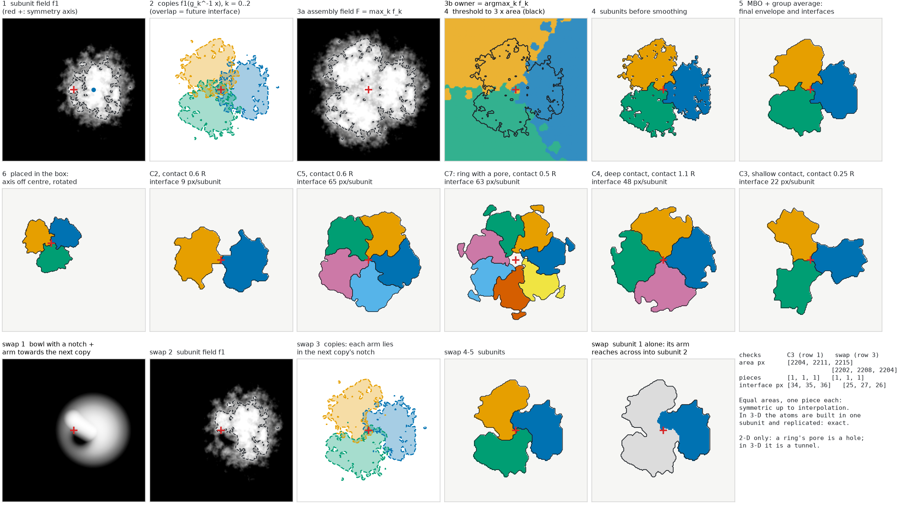

# Symmetric assemblies (Cn): design note

Status: 3-D Cn envelope and subdivision implemented (`decoygen envelope --symmetry Cn`, `decoygen/symmetry.py`,
`tests/test_symmetry.py`); atoms not yet. 2-D toy below. Started 2026-11-06.

## Why

Many single-particle maps are reconstructed with point-group symmetry. Junk processed with imposed symmetry
(micelles, nanodisc belts, aggregates) also comes out symmetric. Symmetric decoys therefore test whether
symmetry by itself reads as "protein" to model builders and detectors. Multi-domain proteins, internal repeats
and hetero-complexes are other forms of the same thing: one object made of units.

| | units on one chain | separate chains |
|---|---|---|
| different units | multi-domain protein | hetero-complex |
| identical units | internal repeats | symmetric homo-oligomer (Cn, Dn, T, O, I, helical) |

We start with Cn. The design takes a symmetry group as a **list of rotation matrices**, so Dn and the cubic
groups only need different lists, and C1 is the existing envelope.

## Envelope and subdivision: competing copies of one subunit field

Figure: [`figures/symmetry_cn_toy2d.png`](figures/symmetry_cn_toy2d.png) (2-D toy).



1. **Subunit field.** `f1 = c + a·r − b·q` is the existing envelope field (METHODS §4.2–4.3): the coarse
   and fine Gaussian random fields `c` and `r`, and the confinement `q`. It lives in the subunit's own frame,
   with `q` a bowl of radius R centred at distance `r_axis` from the symmetry axis.
2. **Copies.** `f_k(x) = f1(g_k⁻¹ x)` for every operation `g_k` of the group (Cn: rotation by 2πk/n),
   sampled by interpolation. Where copies overlap, interfaces will form.
3. **Competition.**
   - Assembly field: `F = max_k f_k`.
   - Owner of each point: `argmax_k f̃_k`, where `f̃` is `f` lightly smoothed (σ = 1.5 px in the toy).
   - The interfaces are where two copies' fields are equal. They are curved, as rough as the surface and
     interlocking, unlike the flat planes of a Voronoi split.
4. **Threshold.** `F > t`, with `t` chosen so the area (volume) is n·A, as METHODS §4.4.
5. **Symmetrise every step that ignores symmetry.** Steps such as MBO smoothing (§4.5) and hole filling are
   followed by group averaging, `m ← mean_k m(g_k⁻¹ x)`, then a re-threshold to the target volume. This keeps
   the envelope exactly Cn up to interpolation, for any group. Owner islands are then handed to the
   surrounding subunit; every copy gets the same treatment, so this keeps the symmetry.
6. **Placement.** The finished assembly gets a rigid transform, so the axis need not pass through the box
   centre.

**Contact depth** is the knob for interfaces. It is the overlap of neighbouring bowls in units of R, and the
axis distance follows from it, here for Cn:

    r_axis = (2 − contact) · R / (2 sin(π/n))

The real target is the **interface area per subunit**, to be calibrated against Cn oligomers in the PDB.
Shallow contacts give narrow necks (row 2, C2 at 0.6 R), so the overlap alone is not a good description.
A disconnected assembly (copies that do not touch) is an error, not silently trimmed to its largest piece.

**Domain swap** (row 3):
- In a monomer, the arm would dock in a slot S on the body's edge facing the previous copy.
- In the swapped assembly the body gives that slot up: a notch, `q += 3·swap·exp(−|x − S|²/(0.42R)²)`.
- An arm (a capsule of radius 0.38 R) runs from the body to the next copy's slot, g·S. That slot sits on the
  next copy's edge facing us, so the arm crosses the interface and docks in the neighbour's notch.
- Areas stay equal and each subunit stays one piece. In the figure, subunit 1 hooks into subunit 2.

**What the toy showed** (first-pass problems, fixed in the version shown):
- Ownership decided on the rough fields splits each subunit into 5–8 islands. The fix is to decide it on
  smoothed fields, then hand islands to the surrounding subunit.
- Parametrising by the distance from the axis lets copies miss each other. The largest-component step then
  silently dropped subunits, so contact depth is the knob instead.
- A slot placed in the gap between copies produces no visible swap. The slot must be on the neighbour's body.

## 3-D implementation: what changed from the toy

`decoygen envelope --symmetry C3 [--contact 0.6] [--swap 1] [--axis z|random|x,y,z] [--shift X Y Z]` writes
`NAME_envelope.mrc`, `NAME_subunits.mrc` (labels), one 0/1 map per subunit, `NAME.json` (operators, checks) and
`NAME.cxc` (ChimeraX). `--mass-kda` is the whole assembly's mass. Slice views: `experiments/symmetry/slices3d.py`.

- **Ownership field.** Each copy's claim on a voxel is decided by `coarse + w·a·fine − b·q`, smoothed by
  σ = 1.5 Å. The outer surface uses the full field (`w = 1`), so it keeps its calibrated roughness.
  - **Default `owner_fine` w = 0.3.** With `w = 1`, interfaces split into fingers near the axis.
  - **Why near the axis.** Every copy's bowl takes the same value on the axis, so the bowl's gradient across
    an interface vanishes there. Interface position then shifts by roughly (noise amplitude) / (bowl gradient),
    so the fine roughness alone decides ownership.
  - **Why 3-D is worse than 2-D.** In 2-D these ties happen at one point. In 3-D they run along the whole
    axis, through the assembly's thickness, and each interface is a surface with more room to fold.
  - **Effect.** w = 0.3 cut the interface area per subunit by 34 % (C3) and 32 % (C5). w = 0 gains only
    another 3–4 %.
- **Domain swap.** The arm needs a lobe at its tip the same size as the notch (`SLOT` = 0.45 R), so the
  volume one subunit gives up is the volume its neighbour's arm takes. A thin arm alone has too little volume
  in 3-D, and just opens a cleft. Measured as the fraction of each subunit lying nearer a neighbour's bowl
  centre than its own:

  | | no swap | swap 1.0 |
  |---|---|---|
  | C2 | 0.051 | 0.075 (interlocking hooks across the axis) |
  | C3 | 0.034 | 0.061 (still partly a cleft: to tune) |
  | C5 | 0.051 | 0.135 |
- **Symmetry error.**
  - Exactly 0 for C2 and C4, whose rotations map grid points onto grid points.
  - 1.4–2.3 % of voxels for C3–C7, and 4.5 % for an oblique, off-centre axis: interpolation of the copies.
  - The atoms will be exact, since they are built in one subunit and replicated.
- **Interface area** is counted as voxel faces, which overestimates a smooth surface (staircase).
  It is fine for comparing settings, but not for calibrating against PDB interfaces. That needs a
  smooth-surface area (marching cubes or blurred-mask estimate).
- **Speed.** About 10–20 s per 128³ assembly on CPU.

## Hollow assemblies: a core exclusion (agreed 2026-11-06, not implemented)

In the current design the subunit sits at a fixed distance from the axis, set by contact and n, so a ring has a
pore only when 2 sin(π/n) < 2 − contact (n ≳ 5 at contact 0.6). Hollowness gets its own random switch:

- **Core term.** With probability p (a Bernoulli draw that depends on group and n), every copy's
  confinement gets the same extra term, a channel along the Cn axis: q += w·exp(−d_axis²/ρ²). The term is
  group-invariant, so the result stays symmetric. It acts on the field before the threshold, so the material
  is pushed outward to keep the volume; nothing is erased afterwards.
- **Pore radius ρ is the controlled quantity.** It is drawn from a distribution, and may vary along the axis
  (funnels, constrictions). The ring's outer radius follows from volume conservation.
- **Contact and core are independent knobs.**
- **Cavity filling.** Fill only voids that the mask cuts off from the solvent and that are not part of the
  core exclusion region.
- **No topology requirement on the pore.** It may be an open channel, a bowl closed at one end, or fully
  enclosed. All are allowed, so there is no open-channel check.
- **Cages come from the symmetry itself.** T, O and I place their subunits over a sphere, and the
  contact rule (computed from the group's rotations) makes the shell. No core term is needed for them.
- **Calibration.** p(core | group, n) and the pore-radius distribution are calibrated against PDB oligomers
  (see TODO).

## Atoms: build symmetrically along the way, not symmetrise at the end

A tight interface cannot be made by building one asymmetric unit (ASU) through the whole ladder and copying it
at the end. The copies would clash or leave a gap. Each side of an interface has to relax against the other at
every step. The plan:

- **A model file holds the ASU atoms plus the symmetry operations,** like PDB BIOMT records. They go in a
  `REMARK 999 DECOYGEN SYMMETRY C3 ...` header line with the axis and centre.
- **Every step moves only ASU coordinates,** but its energy includes the images. On each relaxation
  iteration the ASU is transformed by `g_2..g_n`, and steric and non-bonded terms between the ASU and its
  images enter the loss. Gradients flow back to the ASU, so both sides of every interface relax together.
  The result is exactly symmetric by construction, with no averaging of atoms. This is how crystallographic
  refinement treats symmetry mates.
- **Confinement:** the ASU stays inside its own subunit region (owner = its label, so a swapped arm is
  included). The interface is the shared boundary with the images.
- **Per step:**
  - gas: placed in the ASU region only.
  - hard-core: overlaps checked against images too.
  - polymer, thread, peptide, side chains: bonds stay inside the ASU (a swapped arm belongs to its subunit);
    sterics include images.
  - thinning and side-chain placement: clashes scored against images as well.
- **Rendering** expands the ASU to all n copies. Symmetrised half-map noise is optional: reconstruction
  with imposed symmetry symmetrises the noise as well, which makes it correlated on the axis.
- **Rung guards:** a step refuses mixing symmetric and asymmetric input unless `--force` is given. `mirror`
  keeps Cn and Dn.

Cost: n − 1 extra neighbour evaluations per iteration, or only images within the cut-off of the ASU boundary,
which for Cn means two neighbours.

## Reproducing the figure

```
/proj/liu-folab-cryoem-dev/users/x_bjfor/.conda/envs/decoy/bin/python \
    experiments/symmetry/toy2d.py docs/figures/symmetry_cn_toy2d.png
```

The run is deterministic (fixed seeds; reruns are byte-identical) and takes about 1 min on CPU. It was made
with numpy 2.4.6, scipy 1.17.1 and matplotlib 3.11.2 on top of commit e30bf4b, with the toy script added.

Toy parameters:
- grid 256², subunit area 2200 px² (R = 26.5 px)
- field: α = 3.6 (2-D: H = 0.8), fine amplitude 0.55, confinement weight 1.6
- smoothing: MBO σ = 2 px, ownership smoothing σ = 1.5 px
- row 1: C3, contact 0.6 R, seed 4
- row 2: C2 (0.6 R, seed 1), C5 (0.6, 2), C7 (0.5, 3), C4 (1.1, 5), C3 (0.25, 6); placement rotation
  0.7 rad, shift (−40, 30) px
- row 3: C3, contact 0.6 R, swap 1.0, seed 4

**Caption (draft):** *Symmetric envelope and subdivision, 2-D toy. Row 1: (1) one subunit's rough field, with
the confinement bowl centred off the symmetry axis (red +); (2) its C3 copies; (3a) the assembly field, the
maximum over copies, and (3b) ownership, the strongest copy; (4) threshold to three subunit areas;
(5) smoothing made symmetric by group averaging, giving the final envelope and interfaces. Row 2: the assembly
placed off-centre, and variants C2–C7 with different contact depths, including a ring with a pore. Row 3:
domain swap. Each subunit gives up a slot (notch) and sends an arm into the neighbour's slot; the last panel
shows one subunit alone.*

## Next

- 3-D `decoygen envelope --symmetry Cn`, writing the envelope, a subunit label map and the operations
  (see [TODO](TODO.md)).
- Calibrate interface area, pore size and swap frequency against PDB Cn oligomers.
- Images in the relaxation of every ladder step, as above.
